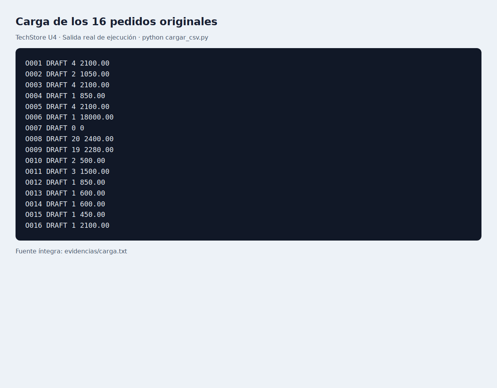
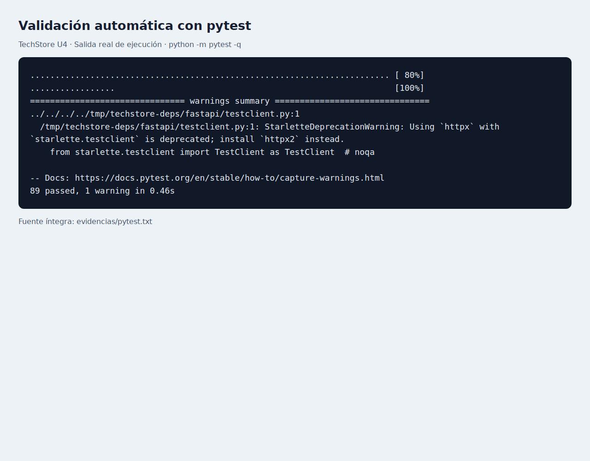
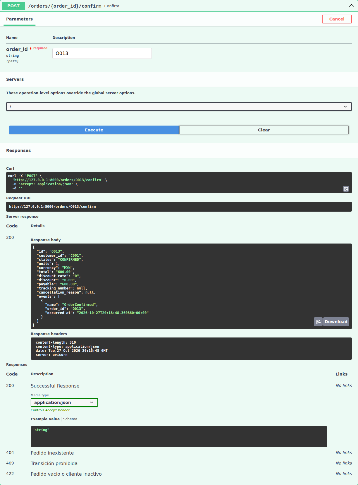
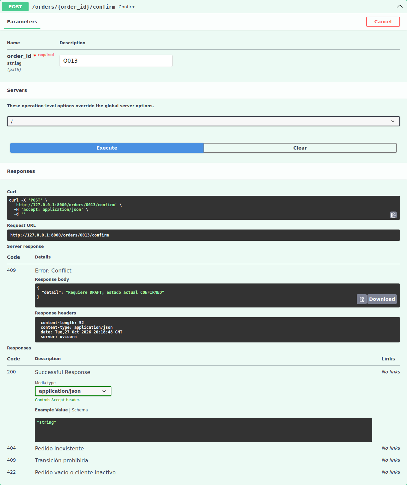

# TechStore U4

Componentes de Lógica de Negocio · Actividad 4 · FIME UANL.
Administra pedidos a partir de los CSV originales mediante un dominio Python, Specifications, máquina de estados y API REST con FastAPI. No requiere base de datos.

## Instalación y ejecución

Requiere Python 3.11+. Validado en Python 3.12.14. Abre una terminal en la carpeta del proyecto:

```bash
python -m venv .venv
```

Activa el entorno en Windows CMD con `.venv\Scripts\activate.bat`, en PowerShell con `.venv\Scripts\Activate.ps1`, o en macOS/Linux con `source .venv/bin/activate`.

```bash
python -m pip install -r requirements.txt
python cargar_csv.py
python -m pytest -v
python scripts/ejecutar_escenarios.py
python -m uvicorn app.api:app --reload
```

Si PowerShell bloquea la activación, usa `.venv\Scripts\python.exe` en lugar de `python`, sin cambiar políticas del equipo.

Abre [Swagger](http://127.0.0.1:8000/docs) o [OpenAPI](http://127.0.0.1:8000/openapi.json). Los recursos de Swagger se sirven localmente, sin CDN.

## Reglas

- Money es inmutable, usa Decimal y rechaza negativos, valores no finitos y float. `add()` exige monedas iguales. Los pedidos aceptan MXN.
- Cantidades enteras positivas. Máximo 20 unidades **sumadas**, no 20 líneas.
- Todos los pedidos empiezan DRAFT; solo DRAFT permite agregar artículos.
- Descuento 10%: VIP, total bruto >500, al menos 4 unidades y sin promoción.
- Descuento 5%: total bruto >5000 y sin promoción. El 10% tiene prioridad; no se acumulan.
- Descuento redondeado a centavos con ROUND_HALF_UP. `total` es bruto, `discount` es descuento y `payable` es neto. Cotizar no muta ni emite eventos.
- Confirmar exige artículos y cliente activo. Enviar exige CONFIRMED y guía no vacía; cancelar exige CONFIRMED y motivo no vacío. Entregar y devolver exigen SHIPPED.
- Un rechazo no cambia el agregado ni añade eventos. Los pasos válidos previos de una secuencia se conservan.
- La existencia del catálogo es contextual: no se valida ni descuenta inventario.
- Repositorio en memoria por proceso. Reiniciar borra cambios y recarga CSV. Usar un solo proceso de servidor. Ejecutar el cargador no modifica un servidor ya iniciado.

## Endpoints

| Método | Ruta | Entrada | Resultado |
|---|---|---|---|
| GET | `/orders` | Sin cuerpo | Lista de 16 pedidos |
| GET | `/orders/{order_id}` | ID | Estado, unidades, importes y eventos |
| POST | `/orders/{order_id}/items` | `{"sku":"SKU003","quantity":1}` | Agrega desde catálogo |
| POST | `/orders/{order_id}/confirm` | Sin cuerpo | CONFIRMED |
| POST | `/orders/{order_id}/ship` | `{"tracking_number":"GUIA-001"}` | SHIPPED |
| POST | `/orders/{order_id}/cancel` | `{"reason":"Solicitud del cliente"}` | CANCELLED |
| POST | `/orders/{order_id}/deliver` | Sin cuerpo | DELIVERED |
| POST | `/orders/{order_id}/return` | Sin cuerpo | RETURNED |

HTTP 200: éxito; 404: pedido o SKU inexistente; 409: transición prohibida; 422: datos inválidos o regla de cantidad. Los importes JSON son cadenas decimales para no convertir dinero a float. Crear pedidos con POST es opcional en la guía; esta entrega trabaja con los 16 pedidos cargados y permite añadir artículos.

## Demostración en Swagger

1. Inicia el servidor y abre `/docs`.
2. Expande `POST /orders/{order_id}/confirm`, pulsa **Try it out**, escribe `O013` y pulsa **Execute**: 200, CONFIRMED y OrderConfirmed.
3. Pulsa **Execute** de nuevo: 409; conserva CONFIRMED y un solo evento.
4. Usa `O007` para 422 por pedido vacío y `NO-EXISTE` para 404.
5. Reinicia el servidor antes de repetir casos independientes.

## Archivos

- `app/domain.py`: entidades, Value Objects, excepciones, transiciones y eventos.
- `app/specifications.py`: AND, OR, NOT y descuentos.
- `app/api.py`: API y repositorio en memoria.
- `app/scenarios.py`: ejecución aislada de E01–E15.
- `datos/`, `cargar_csv.py`, `README.txt`: originales sin modificaciones.
- `tests/`: pruebas del dominio, API y escenarios.
- [Bitácora completa](docs/BITACORA.md) y [tabla CSV](docs/BITACORA.csv).
- [Reporte y reflexión](docs/REPORTE.md), [diagrama](docs/estados.svg).
- `evidencias/`: capturas, logs, resultados JSON y contrato OpenAPI.

## Evidencias reproducibles

Las capturas de Swagger corresponden a solicitudes reales en `/docs`. Las capturas de carga y pytest muestran la salida real guardada en archivos de texto, no una terminal de Windows simulada. Se incluyen los logs completos.






Para regenerarlas, mantén el servidor recién iniciado en otra terminal:

```bash
python -m pip install -r requirements-evidencias.txt
python -m playwright install chromium
python scripts/capturar_evidencias.py
```

Si no detecta un servidor local, el script inicia uno temporal y lo cierra al terminar. Ejecuta el cargador, pytest y E01–E15; utiliza O013 en Swagger. No modifica CSV. Si Linux requiere bibliotecas de navegador, sigue el diagnóstico de Playwright en tu equipo.

## Repositorio GitHub

Proyecto: https://github.com/lighzy/LogicaDeNegociosU4

Para obtenerlo en tu equipo:

```bash
git clone https://github.com/lighzy/LogicaDeNegociosU4.git
cd LogicaDeNegociosU4
```

Después sigue los pasos de instalación de este README. `.gitignore` excluye `.venv`, `__pycache__` y cachés pytest. Se retiró el `__pycache__` que venía en el paquete original.

## Dependencias de terceros

Swagger UI 5.17.14 se incluye en `app/static/swagger/` con sus archivos LICENSE y NOTICE (Apache-2.0). No necesitas Node.js para ejecutar el proyecto.
