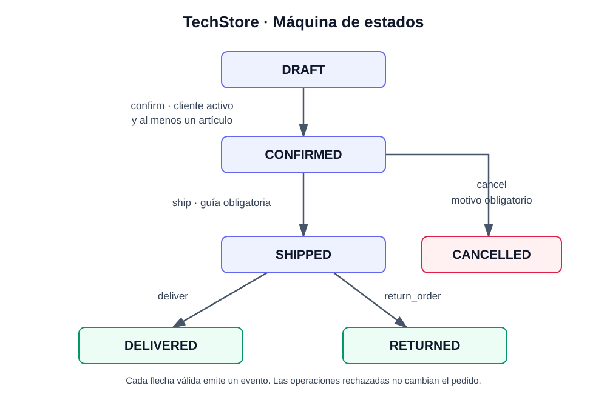
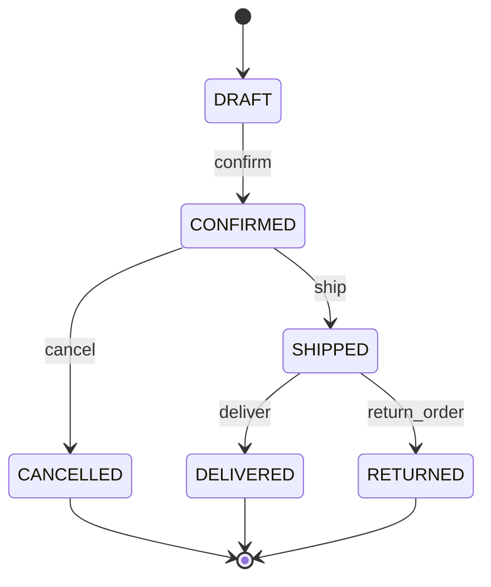

# Implementación del núcleo de negocio TechStore

Componentes de Lógica de Negocio · Unidad 4 · FIME UANL

## Objetivo y resultado

Se implementó un administrador de pedidos con Python y FastAPI, sin base de datos. El cargador original transforma 12 clientes, 12 productos, 16 pedidos y 21 líneas de detalle en objetos. Los 15 escenarios originales tienen pruebas independientes y una bitácora con precondiciones, operaciones, resultados, eventos y prueba asociada. Se conservaron los CSV y las reglas recibidas.

## Arquitectura

`cargar_csv.py` resuelve las relaciones entre archivos y construye el dominio. `Order` es la raíz del agregado: sus métodos concentran las validaciones de cantidad y estado. `Customer` es una entidad identificada por ID; `Money` y `OrderItem` son Value Objects inmutables. Dos clientes con atributos iguales pueden tener identidad distinta; en cambio, un Money se compara por importe y moneda.

`specifications.py` evalúa condiciones puras mediante AND, OR y NOT. La función `calculate_discount` aplica primero 10% y después 5%, sin acumularlos. `api.py` busca el pedido, delega al dominio y transforma sus errores en respuestas HTTP. El repositorio es un diccionario por instancia de aplicación; no persiste cambios.

Las colecciones públicas `items` y `events` son tuplas de consulta. El estado se consulta por una propiedad sin setter. Esto evita cambios accidentales desde la interfaz que omitan los métodos de negocio. Los atributos privados son una convención de encapsulación de Python, no una barrera de seguridad.

## Cálculo manual con los datos originales

| Pedido | Cliente | Detalle | Unidades | Total bruto MXN | Descuento | Neto MXN |
|---|---|---|---:|---:|---:|---:|
| O001 | C001 | SKU001 ×2 a 600 + SKU002 ×2 a 450 | 4 | 2100.00 | 210.00 (10%) | 1890.00 |
| O006 | C006 | SKU008 ×1 a 18000 | 1 | 18000.00 | 900.00 (5%) | 17100.00 |
| O010 | C010 | SKU003 ×1 a 120 + SKU009 ×1 a 380 | 2 | 500.00 | 0.00 | 500.00 |

El total conserva su significado de importe bruto. El neto se muestra como `payable`; evaluar un descuento no altera el pedido.

## Máquina de estados

DRAFT puede confirmarse únicamente con artículos y un cliente activo. CONFIRMED puede enviarse con guía o cancelarse con motivo. SHIPPED puede entregarse o devolverse. DELIVERED, RETURNED y CANCELLED son terminales en este laboratorio. No se permite devolución después de DELIVERED porque la regla de la actividad exige SHIPPED.

## Domain Events

Un Domain Event representa un hecho que ya sucedió. Se registra después de validar y realizar una transición, con nombre, ID de pedido y fecha UTC. No se agrega un evento por una operación rechazada. Las consultas, el cálculo de descuentos y agregar artículos tampoco generan uno de los cinco eventos de este laboratorio.

| Evento | Transición | Información complementaria del pedido |
|---|---|---|
| OrderConfirmed | DRAFT → CONFIRMED | Cliente activo y artículos validados |
| OrderShipped | CONFIRMED → SHIPPED | Guía guardada en tracking_number |
| OrderCancelled | CONFIRMED → CANCELLED | Motivo guardado en cancellation_reason |
| OrderDelivered | SHIPPED → DELIVERED | Entrega válida |
| OrderReturned | SHIPPED → RETURNED | Devolución válida |

No hay bus de mensajería, correo ni descuento de inventario. La lista de eventos permite observar la historia durante la ejecución. Una ampliación podría consumir estos eventos para notificaciones, pero no se implementa ni se simula esa integración.

En E11, confirmar emite OrderConfirmed y enviar sin guía falla: queda CONFIRMED con un evento. En E12, la segunda confirmación falla sin duplicarlo. En E13, cancelar desde SHIPPED falla y se conservan OrderConfirmed y OrderShipped.

## Verificación y alcance

Se comprobaron las 30 combinaciones entre seis estados y cinco operaciones, además de descuentos, frontera de 20 unidades, valores Money inválidos, cliente inactivo, pedido vacío, guía y motivo obligatorios. Se verificaron HTTP 404, 409 y 422 y las rutas de entrega y devolución. Los resultados exactos están en `evidencias/pytest.txt`; los 15 escenarios están en `BITACORA.md` y `evidencias/escenarios.json`.

Las capturas Swagger son del servidor ejecutándose; las capturas de comandos son vistas fieles de los logs producidos durante la ejecución. La advertencia de deprecación de Starlette sobre su integración con httpx, si aparece en pytest, no es un fallo de las pruebas. La entrega conserva el cliente httpx solicitado por la guía y registra la advertencia sin ocultarla.

Los tests adicionales construyen sus propios objetos para aislar condiciones; no cambian los fixtures para hacer pasar E01–E15. No se exige autenticación, persistencia, inventario ni operación distribuida: esta API corresponde al alcance didáctico.

## Respuestas a las preguntas del reporte

**Por qué Decimal y no float.** Decimal representa exactamente los importes decimales escritos como cadenas. Float puede introducir aproximaciones binarias; por ejemplo, la suma de 0.1 y 0.2 no tiene necesariamente la representación exacta de 0.3. Con Decimal se define explícitamente el redondeo a centavos.

**Renglones frente a unidades.** Un renglón de 19 cables cuenta como una línea y 19 unidades. Agregar otro de 2 cables produciría solo dos líneas, pero 21 unidades: por eso debe rechazarse.

**Ventaja de Specification.** Permite expresar condiciones pequeñas, probarlas de forma aislada y reutilizarlas en combinaciones legibles sin duplicar reglas en la API.

**Por qué registrar eventos después de validar.** El evento describe un hecho ocurrido. Emitirlo antes de una validación fallida produciría una historia falsa y podría disparar efectos externos indebidos.

**Qué puede reutilizarse al cambiar FastAPI.** El dominio, las Specifications, los descuentos y sus pruebas. Una CLI u otra interfaz llamaría a los mismos métodos; solo cambiarían el transporte y la traducción de errores.

## Reflexión breve sobre tres problemas encontrados

Esta reflexión describe problemas detectados al revisar el material y verificar la solución, no fallos inventados del estudiante.

1. **El paquete incluía __pycache__.** La entrega pide excluirlo. Se retiró de los archivos entregables y se agregó `.gitignore`. Aprendizaje: los archivos generados por Python no forman parte del código fuente y no deben versionarse.
2. **El caso de 500 pesos no aísla la regla del umbral.** O010 tampoco es VIP y solo tiene dos unidades. Se mantuvo el CSV y se añadieron pruebas con un cliente VIP y cuatro unidades a 500 y 500.04. Aprendizaje: una prueba puede pasar por una condición distinta de la que pretende demostrar.
3. **Swagger no renderizaba OpenAPI 3.1.** La API respondía y sus pruebas pasaban, pero el paquete inicial de Swagger UI solo admitía OpenAPI 3.0. Se sustituyó por Swagger UI 5.17.14, conservando el contrato real de FastAPI, y se verificó la interacción en navegador. Aprendizaje: comprobar HTTP 200 en /docs no basta; también hay que probar que la interfaz carga y ejecuta operaciones.

El aprendizaje central es separar reglas, interfaz y datos. El dominio conserva las invariantes, las pruebas comprueban tanto aceptación como rechazo y los eventos registran únicamente hechos válidos. Antes de entregar, el alumno debe ejecutar el proyecto en su equipo y poder explicar estas decisiones.
